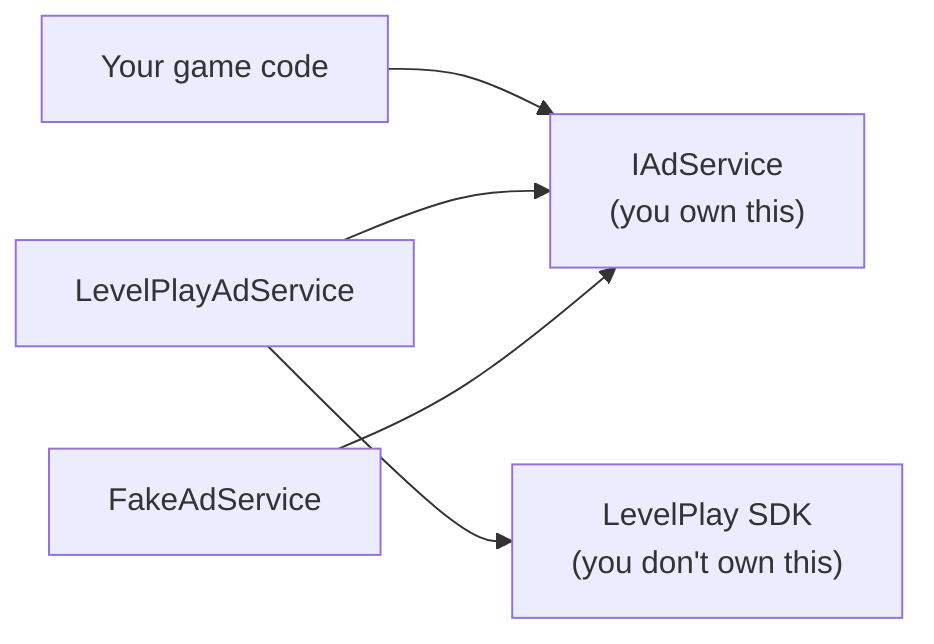

# Writing a shim

A shim is a thin layer of your own code between your game and code you don't control. This guide shows why
that's worth doing, using this package as the example.

## The problem

Third-party SDKs change, and you don't get a say. This one has: ironSource's Unity SDK used to look like
`IronSource.Agent.showRewardedVideo()`, and today's LevelPlay SDK uses `LevelPlayRewardedAd` objects with
their own events. The package moved too, and upgrading to 9.0 came with a migration guide.

Now picture a game that calls the SDK directly:

```csharp
public class ShopScreen : MonoBehaviour
{
    private LevelPlayRewardedAd rewardedAd;

    private void Start()
    {
#if UNITY_ANDROID
        rewardedAd = new LevelPlayRewardedAd("android-rewarded-id");
#elif UNITY_IOS
        rewardedAd = new LevelPlayRewardedAd("ios-rewarded-id");
#endif
        rewardedAd.OnAdRewarded += (info, reward) => coins += 50;
        rewardedAd.OnAdClosed += info => rewardedAd.LoadAd();
        rewardedAd.OnAdLoadFailed += error => StartCoroutine(RetryLoad());
        rewardedAd.LoadAd();
    }
}
```

Imagine this in the shop, the level-end screen and the continue screen. It's brittle in four ways:

- **An SDK change touches every screen.** A renamed event means editing them all.
- **The ad logic is copied.** Each screen has its own loading and retry code, and they drift apart.
- **You can't test it.** To run `ShopScreen`, you need the SDK.
- **You can't switch.** Moving to another ad SDK means rewriting all of them.

## With a shim

```csharp
public class ShopScreen
{
    private readonly IAdService ads;

    public ShopScreen(IAdService ads) => this.ads = ads;

    public void OnWatchAdPressed()
    {
        if (ads.IsRewardedReady) ads.ShowRewarded(() => coins += 50);
    }
}
```

The shop now says what it wants, and nothing about how. The dependencies have changed direction:



Your game and the SDK no longer know about each other. Both point at, or through, code you own. This idea
has a name: the **dependency inversion principle**.

## The five rules

### 1. Ask for what your game needs, not what the SDK offers

LevelPlay has dozens of calls: ad info, bid floors, placement capping, auto-refresh controls and more. A game
needs six things, so `IAdService` has six members, plus `Dispose`.

```csharp
public interface IAdService : IDisposable
{
    bool IsInterstitialReady { get; }
    bool IsRewardedReady { get; }

    void ShowBanner(BannerPosition position = BannerPosition.BottomCenter);
    void HideBanner();

    void ShowInterstitial();
    void ShowRewarded(Action onRewarded);
}
```

Notice what's missing: there's no `LoadAd`. Loading is a chore every screen would repeat, so the shim does it.
A small interface is easy to learn and easy to implement a second time. This is **interface segregation**.

### 2. Vendor types stop at the shim

If `IAdService` used `LevelPlayBannerPosition`, every file that places a banner would depend on LevelPlay,
and the shim would protect nothing. So we have our own type, and one function that translates:

```csharp
public enum BannerPosition { TopLeft, TopCenter, /* ... */ BottomRight }
```

```csharp
private static LevelPlayBannerPosition ToLevelPlay(BannerPosition position)
{
    switch (position)
    {
        case BannerPosition.TopLeft: return LevelPlayBannerPosition.TopLeft;
        case BannerPosition.TopCenter: return LevelPlayBannerPosition.TopCenter;
        // ...
    }
}
```

It feels like duplication, but that's the point. Your enum changes when *you* decide, and only this one
function changes when LevelPlay does.

To check this rule, search your game code for the vendor's namespace. Here, `Unity.Services.LevelPlay` should
appear in exactly one file.

### 3. Only one class touches the vendor

`LevelPlayAdService` is the only class with `using Unity.Services.LevelPlay`. Its job is translation: turning
LevelPlay's objects and events into `IAdService`. That's the **single responsibility principle**, and it gives
every SDK change one obvious place to land.

### 4. One place picks the implementation

Somewhere, code has to choose an implementation. Keep that in one spot:

```csharp
public static IAdService Create(AdConfig config)
{
#if UNITY_ANDROID || UNITY_IOS
    var service = new LevelPlayAdService(config.CurrentPlatform, config.OpenTestSuite);
    service.Initialize();
    return service;
#else
    return new FakeAdService();
#endif
}
```

Then one class in the game, the **composition root**, calls it and hands the result to whoever needs it. In
the sample, that's `AdsDemo`:

```csharp
private void Awake()
{
    ads = AdServices.Create(config);
    coins = new RewardedCoins(ads, coinsPerAd);
}
```

`RewardedCoins` receives its `IAdService` through its constructor, which is **dependency injection**. It doesn't
reach out to a singleton to find one. You can see everything it depends on by reading its constructor, and
that's what makes the next rule work.

### 5. A fake lets you test your game

`FakeAdService` is a second implementation of the interface, and it takes minutes to write. It lets you test
game logic with no SDK, scene or device, including cases that are hard to create for real:

```csharp
[Test]
public void WatchAd_AddsNothing_WhenNoAdIsReady()
{
    var coins = new RewardedCoins(new FakeAdService { IsRewardedReady = false }, coinsPerAd: 50);

    coins.WatchAd();

    Assert.AreEqual(0, coins.Coins);
}
```

A second implementation is also the proof that your interface isn't secretly shaped like the SDK. If the fake is
awkward to write, your interface is leaking.

## A shim absorbs quirks, too

Every SDK has awkward behavior. Without a shim, each of these becomes something your whole game has to know.
Here, each one is a few lines in `LevelPlayAdService`, and callers never hear about it:

| LevelPlay's behavior | What the shim does | What callers see |
|---|---|---|
| A banner's position is fixed when it's created | Destroys it and creates a new one | `ShowBanner(newPosition)` just works |
| Banners shouldn't be shown before they load | Remembers the request, and shows it on load | `ShowBanner` works at any time, even at startup |
| Banners fire `OnAdLoaded` again on every refresh | Handles only the first | Nothing |
| A rewarded ad can send its reward after it closes | Keeps the callback until the reward arrives | The callback just runs |
| An ad is used up once shown | Loads the next one when it closes | Ads are simply ready |
| A load can fail with no fill | Waits and tries again | The ad is ready a bit later |

## What a change costs now

| What changes | Files to edit |
|---|---|
| LevelPlay renames an event | `LevelPlayAdService.cs` |
| You switch to another ad SDK | A new class, plus one line in `AdServices.cs` |
| Premium players should see no ads | A new `NoAdsService`, plus one line in the composition root |
| You add an ad to another screen | That screen |
| A new designer wants to change ad ids | `AdConfig.asset`, with no code at all |

## When not to write a shim

**Keep it thin.** A shim translates. The moment it starts making its own decisions, it's a product you have to
maintain. This package learned that the hard way: its first version re-implemented mediation itself, with its own
waterfall, network adapters and simulated networks, in over 1,400 lines. LevelPlay already does all of that. Cutting it
down to a thin layer removed about three-quarters of the code and lost nothing a game needed.

**Don't wrap everything.** Shims earn their keep around things that are likely to change and that you don't control:
ads, analytics, in-app purchases, platform services. Don't wrap Unity's `Vector3` or `List<T>`. A layer you'll never
swap is just more code to read.

**Expect to grow it slowly.** Start with what your game uses today. You can always add a method to an interface, but
removing one breaks people. Revenue data isn't in `IAdService` yet because nothing here needs it.

## Exercises

1. **`NoAdsService`.** Write an `IAdService` where nothing is ever ready, for players who paid to remove ads. How many
   existing files did you need to change?
2. **`CappedAdService`.** Write an `IAdService` that wraps another one, and allows only one interstitial every 60
   seconds. This is the **decorator pattern**, and the game can't tell it's there.
3. **Audit your own project.** Pick a third-party SDK you use, and search for its namespace. How many files would a
   breaking change touch? Sketch the interface you'd put in front of it.
4. **Test a screen.** Write a class that shows an interstitial every third level, and test it using `InterstitialsShown`
   on `FakeAdService`.
5. **Second vendor.** Write a sketch of `AdMobAdService`. What did the interface make easy? Where did AdMob not fit, and
   what does that tell you about the interface?
